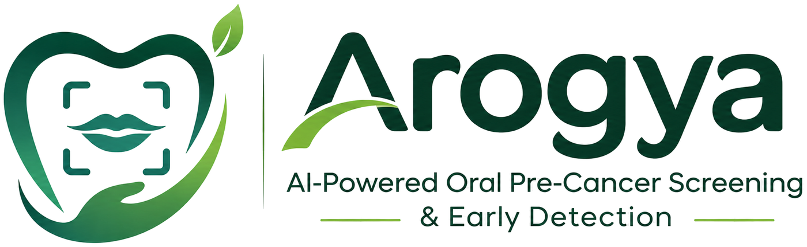
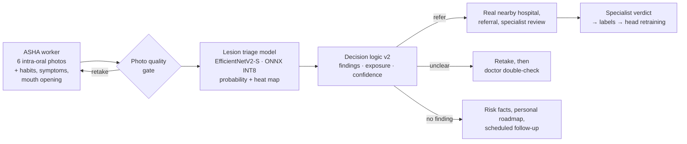

<div align="center">



**AI-assisted early detection of oral cancer for frontline health workers**

[](https://github.com/Mohit-20-m/arogya-bits2wave/actions/workflows/ci.yml)
[](https://github.com/Mohit-20-m/arogya-bits2wave/releases)
[](LICENSE)


*Screening aid only - not a diagnostic device. A specialist confirms every result that needs a referral.*

</div>

---

India accounts for roughly a third of the world's oral cancer cases, and most are found late - although the
disease is usually preceded by visible, treatable changes (leukoplakia, erythroplakia, oral submucous fibrosis)
that a trained eye can spot in a photograph. **Arogya** puts that first look in the hands of community health
workers (ASHAs) in Dakshina Kannada: they photograph the mouth, record habits and symptoms, and the system decides -
transparently - who needs to see a specialist, finds a real hospital near the patient, and follows them until
they are seen.

> **This release (v0.1.0)** contains the trained model and the complete backend platform. The web app for ASHA
> workers, specialists and administrators follows in v1.0.0.

## How it works



The model never decides alone. **Decision logic v2** answers three questions separately - *what is in the mouth
today* (AI evidence and clinical signs), *how exposed is the patient* (tobacco, areca, alcohol) and *how far can
today's assessment be trusted* (photo quality, model availability) - and then picks one action. Habits change
follow-up and counselling, never the finding itself. Every decision comes with a plain-language summary that states
the model's validated accuracy, and every rule set is versioned, approved by a second clinical lead and replayable.

## The model

| | |
|---|---|
| Task | Intra-oral photograph → **refer** (suspicious) / **no refer** |
| Backbone | EfficientNetV2-S (ImageNet-21k), selected over ConvNeXt-Tiny and DINOv2-S |
| Data | 6,665 unique photographs from 8 public sources after duplicate grouping |
| Deployment | ONNX FP32 / INT8 on CPU, about 45 ms per photo on 2 threads; calibrated probability, embedding and CAM heat map |

**Held-out test set** (346 photographs, screening threshold 0.78, 95 % bootstrap CI):

| AUC | Sensitivity | Specificity | Balanced accuracy |
|:---:|:---:|:---:|:---:|
| **0.969** (0.948-0.987) | **0.914** (0.871-0.952) | **0.950** (0.914-0.981) | **0.932** (0.905-0.959) |

5-fold cross-validation: AUC 0.972 ± 0.007. Full results, per-source breakdown and limitations are in the
[model card](models/MODEL_CARD.md).

## The platform

| Capability | How |
|---|---|
| Reliable field submission | Checksummed photo uploads, idempotent retries and a transactional outbox: no screening is lost on a weak network |
| Photo quality gate | Sharpness, exposure, glare and mouth-tissue checks before any photo is scored |
| AI inference | ONNX Runtime service: probability, heat map, embedding, out-of-distribution check, shadow model |
| Decision logic v2 | Findings, exposure and confidence kept apart; AI evidence bands; fail-safe rules; plain-language summaries; 26 example patients as automated tests |
| Care after the result | Sourced habit-risk facts ("if it continues / if you stop"), a personal roadmap the ASHA ticks off on visits, in English, Kannada and Hindi |
| Real hospitals | Nearby hospitals and dental colleges from OpenStreetMap with road travel times (OSRM); the chosen hospital becomes the referral |
| Specialist workflow | Risk-sorted queue, heat maps, similar confirmed cases, verdicts that become training labels |
| Monitoring | Real service health checks every minute, uptime history, host load and alerts |
| Privacy and compliance (DPDP) | Versioned consent texts, separate messaging consent, guardian consent for minors, data export, erasure, nightly retention |
| Security | Keycloak, OPA policies, PostgreSQL row-level security, hash-chained audit log, Vault secrets |
| MLOps | Head retraining on specialist labels, fixed benchmark, shadow mode, approval and rollback |
| Interoperability | FHIR R4 resources (Patient, Observation, DiagnosticReport, ServiceRequest and more) |

Built with FastAPI, PostgreSQL 16 (PostGIS, pgvector), Celery and Redis, MinIO, Keycloak, Open Policy Agent, Vault,
Traefik and Docker Compose. Details: [architecture](docs/architecture.md),
[decision logic v2](docs/decision-logic-v2.md), [clinical decision rules](docs/clinical-decision-rules.md),
[API](docs/api.md), [security and privacy](docs/security-and-privacy.md), [running the stack](docs/deployment.md).

## Repository

```
├── services/      backend: API, inference service, worker, decision engine, care plans, migrations, tests
├── infra/         PostgreSQL, Keycloak, OPA policies, Vault, Traefik, observability configuration
├── ops/           status, end-to-end demo, chaos tests, backups, reset
├── training/      model training pipeline (scan → dedupe → split → select → CV → train → evaluate → export)
├── notebooks/     the Kaggle notebook used to train model v1.0.0
├── models/        model card, integration contract and evaluation reports (weights via Releases)
├── docs/          architecture, decision logic, API, security and privacy, running the stack
└── scripts/       fetch-model.sh - download and verify the released model
```

## Quick start

**Run the platform** (Docker with 5 GB of memory)

```bash
git clone https://github.com/Mohit-20-m/arogya-bits2wave.git && cd arogya-bits2wave
cp .env.example .env
./scripts/fetch-model.sh          # → models/current/ (ONNX FP32 + INT8, head, contract, OOD stats)
docker compose up --build         # first build 10-15 min
./ops/demo.sh                     # end-to-end journey with automatic checks
```

The API and its interactive documentation are at **https://localhost/api/docs** (self-signed certificate). Demo
accounts, optional profiles and messaging setup are described in [docs/deployment.md](docs/deployment.md).

**Run the reference inference on a photo** (numpy + onnxruntime only)

```bash
pip install onnxruntime numpy pillow
python training/oralscreen/inference_reference.py --artifacts models/current --image mouth.jpg
```

**Run the backend tests**

```bash
cd services && pip install -r requirements.txt pytest && pytest -q tests
```

**Retrain from scratch** - see [`training/README.md`](training/README.md) (Kaggle, 2 × T4, about 2-4 hours).

## Roadmap

- [x] **v0.1.0** - Lesion triage model, training pipeline, model card, and the backend platform: inference,
  decision logic v2, care plans, real hospital search, specialist workflow, monitoring, privacy and audit
- [ ] **v1.0.0** - Web app for ASHA workers, specialists and administrators: guided capture, voice-guided
  screening in three languages, awareness film, hospital map and personal roadmap
- [ ] Field validation on photographs taken by ASHA workers, and head retraining on specialist-confirmed cases
- [ ] Offline-first Android app sharing the same API and model

## Responsible use

Arogya is a research prototype. The model was trained on public datasets of uncertain provenance and has **not**
been validated prospectively or on photographs taken by health workers in the field. It must not be used to rule
out disease, and every positive screen must be confirmed by a qualified clinician. The health content (risk facts,
roadmap steps) still needs review by an oral medicine specialist, and the Kannada and Hindi text by native
speakers. See the [limitations](models/MODEL_CARD.md#limitations).

## Acknowledgements

Training data comes from public datasets shared by their authors on Kaggle (`zaidpy/oral-cancer-dataset`,
*Mouth and Oral Diseases* / Teeth_Dataset, `salmansajid05/oral-diseases`, `mohitmural/oral-cancer-lips-and-tongue`)
and Roboflow Universe (leukoplakia and aphthous-ulcer projects). Pretrained backbones from
[timm](https://github.com/huggingface/pytorch-image-models). Hospital data © OpenStreetMap contributors (ODbL).
The images themselves are not redistributed here.

## License

Code: [MIT](LICENSE). Model weights are released for research use; the licences of the underlying datasets apply.
If you use this work, please cite it - see [`CITATION.cff`](CITATION.cff).
